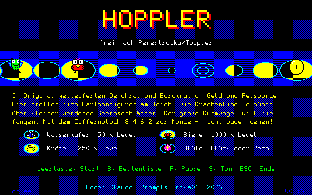

# DMV Games

Spiele und Programme für den NCR Decision Mate V (DMV) mit Farbgrafik (µPD7220) unter MS-DOS und CP/M-8000.
Games and programs for the NCR Decision Mate V (DMV) with colour graphics (µPD7220) under MS-DOS and CP/M-8000.

| Spiel / Game | Verzeichnis / Directory | Diskette / Disk image |
|---|---|---|
| **Hoppler** – frei nach Perestroika/Toppler / loosely based on Perestroika/Toppler | [`hoppler/`](hoppler/) | [`images/HOPPLER-V0.18.IMG`](images/HOPPLER-V0.18.IMG) |
| **Mahjongg** – Solitär mit Maus, CP/M-8000 (K238) / solitaire with mouse, CP/M-8000 (K238) | [`mahjongg/`](mahjongg/) | [`images/MAHJONGG-8000-V0.12.IMG`](images/MAHJONGG-8000-V0.12.IMG), [`-68K-`](images/MAHJONGG-68K-V0.12.IMG) (320 KB, CP/M-Datendisketten / data disks), [`-DOS-`](images/MAHJONGG-DOS-V0.12.IMG) (360 KB) |
| **DMVBD** – „Before Dawn“, After-Dark-Bildschirmschoner unter DOS / After Dark screen savers under DOS | [`dmvbd/`](dmvbd/) | [`images/DMVBD-V0.1.IMG`](images/DMVBD-V0.1.IMG) |

## Aufbau / Layout

- je Spiel ein Verzeichnis mit Quellen und Werkzeugen / one directory per game with sources and tools
- `images/` – 360-KB-Diskettenabbilder (DMV-Format, 40 Spuren, 2 Seiten, 9 Sektoren), Version im Dateinamen / 360 KB disk images, version in the file name

Getestet in MAME (Treiber `dmv`). Tested in MAME (`dmv` driver).

## Lizenz / License

MIT, siehe [LICENSE](LICENSE). Die Spiele brauchen keine fremden Bibliotheken: Grafik, Schrift und Ton
stammen aus der eigenen `DMVGFX.INC` (siehe [`hoppler/`](hoppler/)).
MIT, see [LICENSE](LICENSE). No third-party libraries needed: graphics, font and sound come from our own
`DMVGFX.INC` (see [`hoppler/`](hoppler/)).

Code: Claude (Anthropic) · Idee und Prompts / idea and prompts: rfka01
