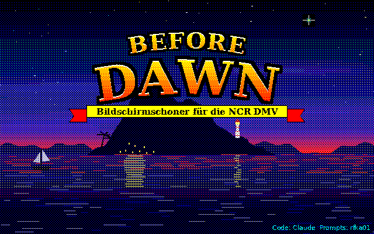
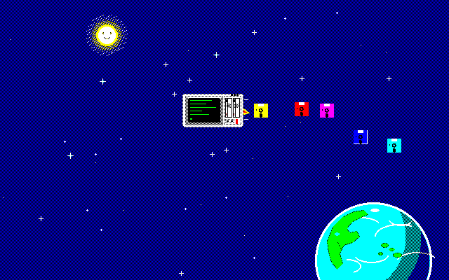
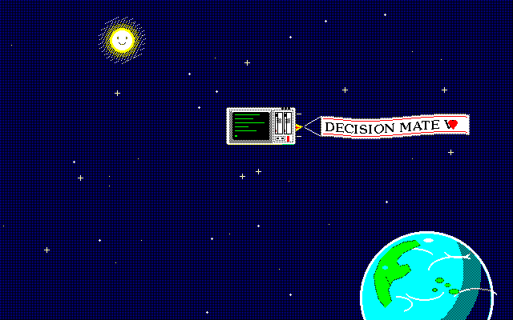
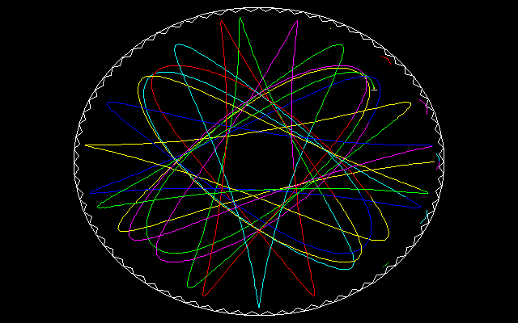
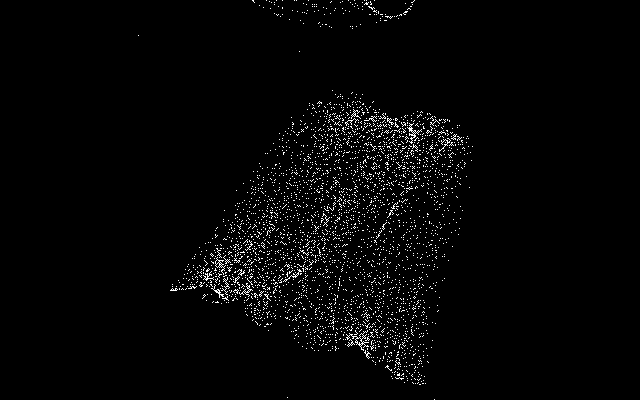

# DMVBD – „Before Dawn“

*Abspieler für After-Dark-kompatible Bildschirmschoner-Module auf der NCR DMV – player for After-Dark-compatible screen saver modules on the NCR DMV*

Version 0.2 (11.11.2026, Testfassung / test release) – Diskette / disk image: [`../images/DMVBD-V0.2.IMG`](../images/DMVBD-V0.2.IMG)

*Screenshots: Testumgebung / test harness; Stand: in MAME getestet / tested in MAME*

## Deutsch

DMVBD lädt Bildschirmschoner-Module im Format von After Dark 1.0 für Windows 3.0 (Win16-DLLs, Real Mode)
und lässt sie ohne Windows unter MS-DOS auf der DMV laufen. Ein kleiner NE-Lader bindet die Module,
eine Win16-Schicht (KERNEL/USER/GDI, soweit nötig) bedient ihre Aufrufe, und ein Bildschirmtreiber nach dem
Vorbild der Windows-3.0-DDI zeichnet über den µPD7220 (GCHRD-Flächen, Hardware-Rollen, Blitter in Assembler).

Eigene Module auf der Diskette:

- **FLYDMV.AD** – eine DMV fliegt durchs All und stößt Disketten in Regenbogenfarben aus oder zieht ein Banner
  „DECISION MATE V“ hinter sich her
- **PICKOVER.AD** – seltsame Attraktoren nach Clifford Pickover, ziehen von unten nach oben durchs Bild
- **SPIRO.AD** – Spirograph: Zahnkranz, Mittelrad, Rad im Rad, Oval, Dreieck
- **DMVWARP.AD** – Schriftzug DECISION MATE V mit Regenbogen-Schweif

**Aufruf:** `DMVBD [modul] [/M | /C] [/N] [/R:n] [/?] [/1=w … /4=w]` – Endung `.AD` darf fehlen;
`/R:n` wechselt alle n Minuten das Modul; Taste **E** öffnet die Einstellungen (gespeichert in `DMVBD.INI`).
**DMVBDTSR.COM** (560 Byte resident) startet DMVBD, wenn am DOS-Prompt eine Zeit lang keine Taste kam:
`DMVBDTSR [n | nS] [DMVBD-Angaben]` (n Minuten, Vorgabe 5; nS Sekunden), `DMVBDTSR /U` entfernt es. Es nutzt nur
DOS (INT 21h), keine Hardware-Interrupts, und läuft deshalb auch mit K230/K231 ohne 8259.
Alles Weitere in [LIESMICH.TXT](LIESMICH.TXT). Welche Module von After Dark 1.0 laufen: [ADLISTE.TXT](ADLISTE.TXT).

**Braucht:** DMV mit 8088-Karte und MS-DOS, Farbe oder Monochrom (Kennbuchstabe im ROM, `/M` `/C` erzwingen).

Die eigenen Module sind auch für After Dark 1.0 unter Windows 3.0 gebaut.

After-Dark-Module gehören nicht zu DMVBD und liegen weder hier noch auf der Diskette.

## English

DMVBD loads screen saver modules in the After Dark 1.0 for Windows 3.0 format (Win16 DLLs, real mode) and runs
them without Windows under MS-DOS on the DMV. A small NE loader links the modules, a Win16 layer
(KERNEL/USER/GDI as far as needed) serves their calls, and a display driver modelled on the Windows 3.0 DDI
draws through the µPD7220 (GCHRD fills, hardware scrolling, assembler blitter).

Own modules on the disk: FLYDMV (flying DMV with rainbow floppies or a banner), PICKOVER (Pickover strange
attractors scrolling upwards), SPIRO (spirograph with several wheel types), DMVWARP (text logo with rainbow trail).

**Usage:** `DMVBD [module] [/M | /C] [/N] [/R:n] [/?] [/1=v … /4=v]` – `.AD` may be omitted; `/R:n` rotates
modules every n minutes; key **E** opens the settings (stored in `DMVBD.INI`).
**DMVBDTSR.COM** (560 bytes resident) starts DMVBD after n minutes without a key at the DOS prompt (`/U` removes it);
it only uses DOS (INT 21h), no hardware interrupts. Details (German) in LIESMICH.TXT,
After Dark compatibility list in ADLISTE.TXT.

The own modules are also built for After Dark 1.0 under Windows 3.0.

After Dark modules are not part of DMVBD and are neither included here nor on the disk.

## Bauen / Building

`build.sh` mit / with Open Watcom (`WATCOM` gesetzt / set) und JWasm (`JWASMEXE`). Die EXE enthält die
Laufzeitbibliothek von Open Watcom / the EXE contains the Open Watcom runtime library.

- `src/` – DMVBD.EXE: BD.C (Hauptprogramm), NELOAD.C (NE-Lader), W16.C (Win16-Schicht), DRV7220.C + BLT86.ASM
  (Treiber), GPICW.ASM/GPIC.INC (PIC-Lader aus DMVGRAF)
- `src/W16TAB.C` – Einsprungtabellen, erzeugt von `tools/mktab.py` aus den .spec-Dateien von Wine (nicht beigelegt) /
  generated from Wine's .spec files (not included)
- `tsr/DMVBDTSR.ASM` – das TSR / the TSR (JWasm, `-bin`)
- `titel/` – Startschirm (`mktitel.py` → DMVBD.PIC), `flydmv/ pickover/ spiro/ dmvwarp/` – Module mit Grafik-Erzeugern
- `tools/win16sim.py` – Python-Prototyp der Win16-Schicht / Python prototype of the Win16 layer

Code: Claude (Anthropic) · Prompts: rfka01
