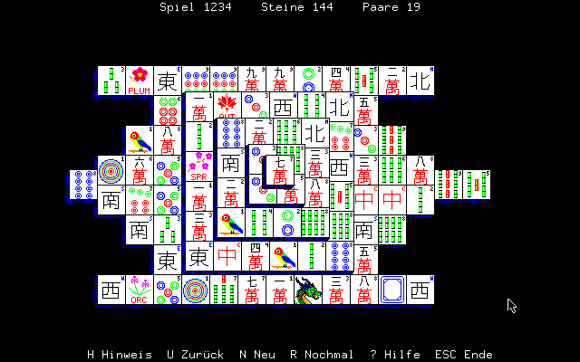
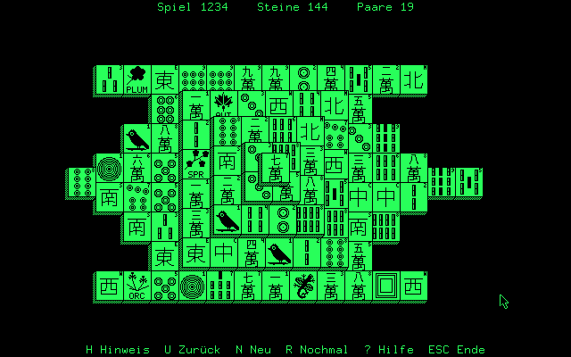
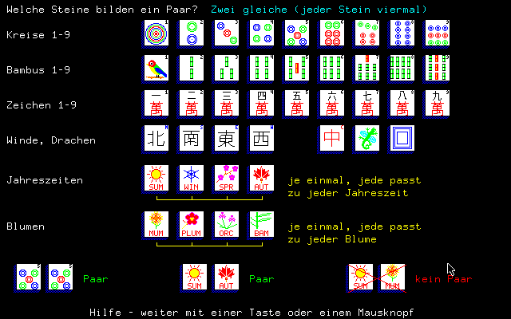

# Mahjongg

*Mahjongg-Solitär für die NCR DMV – Mahjongg solitaire for the NCR DMV*

Version 0.12 (5.11.2026, mit DMVGRAF vom 4.11.2026 neu übersetzt / rebuilt with DMVGRAF as of 4 Nov 2026; das Spiel selbst ist unverändert seit 0.10 / the game itself is unchanged since 0.10). 0.10 in MAME getestet / tested in MAME: CP/M-8000 (direkt am 7220 und mit `/B` über BIOS 66/67 / straight to the 7220 and with `/B` through BIOS 66/67), CP/M-68K (unser 1.3 v005 und NCRs 1.2), MS-DOS 3.30

*Bilder aus der PC-Simulation / pictures from the PC simulation*

## Deutsch

Das bekannte Legespiel: 144 Steine als Schildkröte aufgebaut, gleiche Paare abräumen. Ein Stein ist frei, wenn nichts auf ihm liegt und links oder rechts kein Nachbar ist. Jedes Spiel ist lösbar (die Steine werden in einer lösbaren Reihenfolge rückwärts verteilt).

- Bedienung mit der Maus (K806): linker Knopf wählt, rechter zeigt einen Hinweis. Ohne Maus: Cursortasten springen zum nächsten freien Stein, Leertaste/Enter wählt.
- **H** Hinweis, **U** Zug zurück, **N** neues Spiel, **R** dasselbe noch einmal, **?** Hilfe (welche Steine ein Paar bilden), **ESC** Ende.
- Kopfzeile: Spielnummer, verbliebene Steine und **Paare** – wie viele Paare im Moment abgeräumt werden könnten (alle Kombinationen freier, zusammenpassender Steine; drei freie gleiche Steine zählen also drei Paare). Die Zahl kann nach einem Zug steigen oder fallen; 0 heißt: kein Zug mehr möglich.
- Der gewählte Stein ist schattiert (Farbe: Weiß im Raster mit Blau; mono: 50-%-Raster).
- Steinsätze im TIL-Format von Nels Andersons Mahjongg (42 Steine, 40 × 40 Punkte, 16 EGA-Farben). Vorgabe ist der eigene, frei verbreitbare Satz `DMVSTEIN.TIL` (aus `tools/mktil.py`, fein mit Linien von einem Punkt gezeichnet; die Schriftzeichen hat `tools/glyphen.py` einmal aus Noto Sans CJK, SIL Open Font License, gerastert und verdünnt). Ein anderer Satz: `MAHJONGG X.TIL`; ohne Spielnummer wird ein zufälliges Spiel gemischt, mit `MAHJONGG 4711` ein bestimmtes. `MAHJONGG /B` schickt alles über BIOS 66/67 statt direkt an den 7220 (zum Vergleich).

Läuft unter **CP/M-8000** (Z8001-Karte K238) ab v015 mit K208 (512 KB): Grafik, Maus und Ton kommen aus **DMVGRAF** (rfka01/dmv_goodies, `dmvgraf/`), die Steinbilder liegen im freien Speicher der K208 (BIOS 72). Unter CP/M-8000 schreibt DMVGRAF direkt an den 7220 (Systemmodus über BDOS 62). CP/M-68K und MS-DOS siehe unten.

### Diskette

[`images/MAHJONGG-8000-V0.12.IMG`](../images/MAHJONGG-8000-V0.12.IMG): 320-KB-Datendiskette (NCR-Format DD320, ohne Systemspuren) mit `MAHJONGG.Z8K` und `DMVSTEIN.TIL` (die DMVGRAF-Tests GTEST und MTEST liegen auf der eigenen Diskette `CPM16TEST` in rfka01/dmv_goodies, `Images/`). CP/M-8000 von A: starten, dann `B:` und `MAHJONGG` eingeben (der Steinsatz wird im aktuellen Laufwerk gesucht). Die Programme sind mit DRs `STARTUP.O` und `LIBCPM.A` gebunden und enthalten damit Digital Researchs C-Laufzeit. Andersons `MAHJONGG.TIL` ist nicht dabei.

### CP/M-68K

Dasselbe Spiel läuft auch auf der 68008-Karte **K234** unter CP/M-68K: unter unserem CP/M-68K (rfka01/dmv_os) und unter NCRs CP/M-68K 1.2, das keinen DMV-BIOS-Block hat – dann spricht DMVGRAF 7220, K806 und den 8741 selbst an. Die Steine liegen im Programm (60 KB), 256 KB Speicher reichen. `MAHJONGG /B` wirkt nur mit BIOS-Block. Mit gcc übersetzt (`make MAHJONGG.68K`, braucht `gcc-m68k-linux-gnu`), ohne DR-Code. Im Prüfstand von DMVGRAF zeigt es dieselben Bilder wie die PC-Simulation. In MAME getestet unter unserem CP/M-68K 1.3 v005 (mit BIOS-Block) und unter NCRs CP/M-68K 1.2 (ohne).

Diskette [`images/MAHJONGG-68K-V0.12.IMG`](../images/MAHJONGG-68K-V0.12.IMG): 320-KB-Datendiskette (DD320) mit `MAHJONGG.68K` und `DMVSTEIN.TIL` (GTEST und MTEST: Diskette `CPM16TEST` in rfka01/dmv_goodies); CP/M-68K von A: starten, dann `B:` und `MAHJONGG`.

### MS-DOS

Unter **MS-DOS** ab 2.11 auf der 8088/V20-Karte (K230/K231/K235): `MAHJONGG.EXE`, mit gcc-ia16 und DMVGRAF übersetzt (`make MAHJONGG.EXE`, bindet `lib/dos/DMVGRAF.A` aus rfka01/dmv_goodies), ohne fremden Code. DMVGRAF spricht 7220, K806 und den 8741 selbst an; die Steinbilder liegen in 64 KB, die das Programm bei DOS anfordert. Im Prüfstand von DMVGRAF (`tools/pruefdos.py`) zeigt es in Farbe und mono dieselben Bilder wie die PC-Simulation; in MAME unter MS-DOS 3.30 getestet. `/B` wirkt unter DOS nicht.

Diskette [`images/MAHJONGG-DOS-V0.12.IMG`](../images/MAHJONGG-DOS-V0.12.IMG): 360-KB-DOS-Diskette (nicht startfähig) mit `MAHJONGG.EXE`, `MAHJONGG.TXT` und `DMVSTEIN.TIL`; DOS von A: starten, dann `B:` und `MAHJONGG`.

### Übersetzen

Unter CP/M-8000 mit DRs `zcc`, `asz8k`, `ld8k`: `src/mahjongg.c`, `src/mj.h` und aus `dmvgraf/src/` die Dateien `DMVGRAF.H GINTERN.H GFONT.H GRAF.C GBILD.C GEIN.C GHWCPM.C GHSEG.C GHDIR.C GSC1.8KN GDIR.8KN GZ8K.8KN` zusammen mit `STARTUP.O` und `LIBCPM.A` auf eine Diskette, dann `SUBMIT MJ` (`src/MJ.SUB`).

Simulation am PC: `make mjsim DMVGRAF=pfad/zu/dmv_goodies/dmvgraf/src`, dann `GSKRIPT=skript.txt ./mjsim` (Skriptzeilen siehe DMVGRAF). `Ctrl-D` räumt ein freies Paar ab (zum Prüfen).

## English

The well-known tile game: 144 tiles stacked as a turtle, remove matching pairs. A tile is free when nothing lies on it and it has no neighbour on its left or right. Every game can be solved (tiles are dealt backwards along a solving order).

- Mouse (K806): left button selects, right button shows a hint. Without a mouse the cursor keys jump to the next free tile, Space/Enter selects.
- Top line: game number, tiles left and **pairs** – how many pairs could be removed right now (all combinations of free matching tiles, so three free equal tiles count as three pairs). It may rise or fall after a move; 0 means no move is left.
- **H** hint, **U** undo, **N** new game, **R** replay, **?** help (which tiles make a pair), **ESC** quit.
- Tile sets in Nels Anderson's TIL format; the default is our own freely distributable set `DMVSTEIN.TIL` (drawn with one-pixel lines; the Chinese characters were rasterised once from Noto Sans CJK, SIL Open Font License, by `tools/glyphen.py`). `MAHJONGG X.TIL` loads another set, `MAHJONGG 4711` a game number, `MAHJONGG /B` sends everything through BIOS 66/67 instead of straight to the 7220 (for comparison).

Runs under **CP/M-8000** (K238 Z8001 card) v015 or later with a K208 (512 KB), and under **CP/M-68K** on the K234 68008 card – ours and NCR's own 1.2 without the DMV BIOS block (DMVGRAF then drives the 7220, K806 and 8741 itself); built with gcc (`make MAHJONGG.68K`), no DR code, disk [`images/MAHJONGG-68K-V0.12.IMG`](../images/MAHJONGG-68K-V0.12.IMG). Under **MS-DOS** 2.11 or later on the 8088/V20 card: `MAHJONGG.EXE`, built with gcc-ia16 (`make MAHJONGG.EXE`), no foreign code, on the 360 KB DOS disk [`images/MAHJONGG-DOS-V0.12.IMG`](../images/MAHJONGG-DOS-V0.12.IMG); tested in MAME under MS-DOS 3.30. The CP/M-68K version is tested in MAME under our CP/M-68K 1.3 v005 and NCR's 1.2. Disk: [`images/MAHJONGG-8000-V0.12.IMG`](../images/MAHJONGG-8000-V0.12.IMG), a 320 KB data disk (NCR DD320, no system tracks) with `MAHJONGG.Z8K` and `DMVSTEIN.TIL` (the DMVGRAF tests GTEST and MTEST are on the `CPM16TEST` disk in rfka01/dmv_goodies); boot CP/M-8000 from A:, change to B: and run `MAHJONGG`. The programs are linked with DR's `STARTUP.O`/`LIBCPM.A` and so contain Digital Research's C runtime; Anderson's `MAHJONGG.TIL` is not included. Graphics, mouse and sound come from **DMVGRAF** (rfka01/dmv_goodies, `dmvgraf/`).

## Lizenz / License

MIT. Code: Claude (Anthropic) · Idee und Prompts / idea and prompts: rfka01
